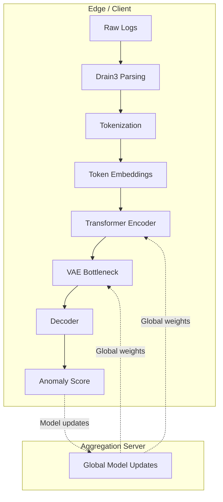

# FedVAE-Trans

A communication-efficient federated variational transformer for privacy-preserving, long-sequence log anomaly detection.

[](LICENSE)
[](https://www.python.org/)
[](https://pytorch.org/)
[](https://flower.dev/)
[](https://modal.com/)

FedVAE-Trans is a research-oriented, privacy-preserving anomaly detection framework for system logs. It combines a transformer-based encoder with a variational bottleneck and trains it in a federated setting using Flower, with FedProx regularization to improve robustness under non-IID data distributions.

This project is designed for long-sequence log anomaly detection in sensitive environments where raw logs cannot be centralized without privacy or communication cost concerns.

## Why this project matters

- Privacy-preserving training without centralizing raw logs
- Robust handling of heterogeneous client data through FedProx
- Efficient communication using compact model updates
- Built for long-sequence log anomaly detection
- Research-friendly architecture with ablations and cloud deployment support

## Key features

- Federated training with Flower
- Variational transformer model variants
- FedProx support for non-IID learning scenarios
- GPU-ready training and serverless execution support with Modal
- Data parsing and preprocessing utilities for logs
- Visualization and evaluation tooling
- Packaging and CI-oriented project setup

## Architecture overview



## Repository structure

```text
FedVAE-Trans/
├── .github/
│   ├── workflows/
│   ├── ISSUE_TEMPLATE/
│   ├── CODEOWNERS
│   ├── dependabot.yml
│   └── pull_request_template.md
├── src/
│   ├── data/
│   ├── federated/
│   ├── models/
│   ├── utils/
│   └── __init__.py
├── cloud/
├── notebooks/
├── scripts/
├── tests/
├── data/
├── README.md
├── ARCHITECTURE.md
├── CONTRIBUTING.md
├── LICENSE
├── pyproject.toml
├── setup.py
├── requirements.txt
├── Dockerfile
├── SECURITY.md
├── .pre-commit-config.yaml
├── demo.py
├── visual_demo.py
└── .gitignore
```

## Model variants

The implementation includes three architecture variants:

- VAEOnly: MLP-based VAE baseline
- TransVAE: Transformer + VAE bottleneck
- BiLSTMTransVAE: BiLSTM pre-encoder + transformer + VAE

The repository currently focuses on the federated transformer setup and includes ablation support for experimentation.

## Requirements

- Python 3.9+
- PyTorch 2.5+
- Flower 1.14+
- CUDA-capable GPU recommended for training speed
- Optional: Modal for serverless cloud execution

## Quick start

### 1) Clone the repository

```bash
git clone https://github.com/Dharshan-K-2904/FedVAE-Trans.git
cd FedVAE-Trans
```

### 2) Create a virtual environment

```bash
python -m venv .venv
source .venv/bin/activate   # On Windows: .venv\Scripts\activate
```

### 3) Install dependencies

Using the project package configuration:

```bash
pip install -U pip
pip install -e .
```

Or, if you want the dev stack:

```bash
pip install -e ".[dev]"
```

### 4) Run the demo

```bash
python demo.py
```

Or launch the interactive visualization:

```bash
streamlit run visual_demo.py
```

## Docker usage

```bash
docker build -t fedvae-trans .
docker run --rm -it fedvae-trans
```

## Training and evaluation

### Centralized baseline

```bash
python demo.py
```

### Federated simulation

```bash
python -m cloud.phase3_federated
```

### Hyperparameter tuning

```bash
python scripts/run_optuna_tuning.py
```

## Configuration

The project exposes model and training hyperparameters through standard Python configuration objects and module constructors. A common pattern looks like:

```python
from src.models.bilstm_trans_vae import BiLSTMTransVAE

model = BiLSTMTransVAE(
    vocab_size=1000,
    d_model=128,
    nhead=4,
    num_layers=2,
    latent_dim=64,
    seq_len=128,
    lstm_layers=2,
    dropout=0.1,
)
```

## Testing

The project includes initial smoke tests for the model path and is structured to support expanded coverage.

Run:

```bash
pytest tests/unit -q
```

For pre-commit checks:

```bash
pre-commit install
pre-commit run --all-files
```

## Contributing

Contributions are welcome. Please read the contribution guide before opening a pull request:

- CONTRIBUTING.md
- CODEOWNERS
- pull request template

Suggested workflow:

```bash
git checkout -b feature/my-improvement
# implement changes
pytest tests/unit -q
git push origin feature/my-improvement
```

## Security

Security-related matters should be handled privately. Please refer to:

- SECURITY.md

## License

This project is licensed under the MIT License. See [LICENSE](LICENSE) for details.

## Acknowledgements

This project builds on the work of the open-source communities behind:

- PyTorch
- Flower
- Modal
- scikit-learn
- LogPai and log parsing utilities
- Related research in federated learning and variational modeling

## Project status

This repository is in active research and development mode with a strong foundation in model design, federated training, and project structure. It is suitable for experimentation, benchmarking, and further hardening for production deployment workflows.

## Citation

If you use this project in research, please cite it as:

```text
Dharshan K, Aparajitha Chandan, and Yeswant Padavala. FedVAE-Trans: Communication-Efficient Federated Variational Transformer for Privacy-Preserving, Long-Sequence Log Anomaly Detection.
```
