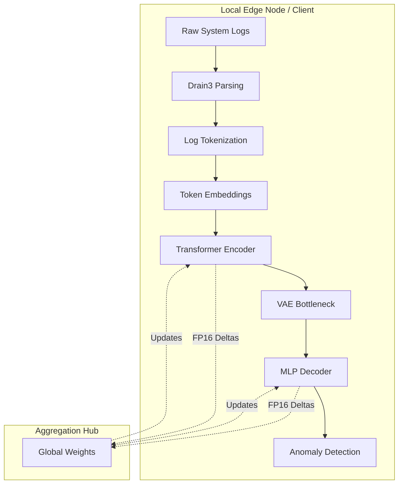

# 🛡️ FedVAE-Trans: Communication-Efficient Federated Variational Transformer

[](https://opensource.org/licenses/MIT)
[](https://pytorch.org/)
[](https://flower.dev/)
[](https://modal.com/)
[](https://pes.edu/)

**A decentralized, privacy-preserving hybrid architecture for unsupervised long-sequence log anomaly detection.** Developed at the Department of Computer Science, **PES University**, this repository implements a highly optimized pipeline that synergizes a BERT-style Transformer encoder with a Variational Autoencoder (VAE) bottleneck. The system operates entirely within a Horizontal Federated Learning topology, safeguarding sensitive operational telemetry by ensuring raw logs never leave their originating edge devices.

---

## 🧠 Architectural Overview

Traditional centralized analytics inherently compromise data security and saturate available network bandwidth by forcing the bulk transmission of sensitive operational logs to a single server. FedVAE-Trans circumvents this vulnerability by computing unsupervised, reconstruction-based anomaly scores directly at the edge. 

To counteract the severe latent space collapse typically induced by Non-IID client data distributions, the architecture integrates **FedProx** proximal regularization. Communication payload overhead is drastically reduced utilizing FP16 mixed-precision weight updates.

### System Flow Diagram



*(Note: Ablation studies within our research confirmed that introducing a BiLSTM pre-encoder yielded redundant feature extraction with no significant F1 gain. Therefore, the primary deployment path utilizes the pure Trans-VAE configuration, while the BiLSTM module remains available in the codebase for experimental ablation testing).*

---

## 🔬 Research Gaps & Novelty Contributions

1. **Unsupervised Deep Sequence Modeling:** Bridges the gap in existing literature, which predominantly relies on supervised or shallow federated models, by introducing a fully unsupervised, high-fidelity Transformer bottleneck.
2. **Non-IID Latent Space Stabilization:** Implements and mathematically bounds latent space collapse utilizing FedProx regularization, maintaining stable Evidence Lower Bound (ELBO) trajectories across highly heterogeneous client workloads.
3. **Bandwidth Optimization:** Achieves a **50.2% reduction** in communication payload volumes through deterministic FP16 mixed-precision weight quantization and pre-trained Transformer initialization.

---

## 📂 Project Structure

```text
FedVAE-Trans/
├── README.md                          # Project documentation
├── requirements.txt                   # Python dependencies
├── demo.py                            # Local interactive demonstration
├── visual_demo.py                     # Streamlit visualization dashboard
├── scripts/
│   ├── setup_env.sh                   # Environment setup automation
│   ├── download_dataset.py            # Dataset acquisition from LogHub
│   ├── sample_data.py                 # Data sampling & preprocessing
│   ├── process_real_data.py           # Production data pipeline
│   └── run_optuna_tuning.py           # Hyperparameter optimization
├── src/
│   ├── __init__.py
│   ├── models/
│   │   ├── __init__.py
│   │   ├── baselines.py               # Baseline & ablation models
│   │   ├── bilstm_trans_vae.py        # BiLSTM pre-encoder variant
│   │   └── ablation.py                # Ablation study configurations
│   ├── federated/
│   │   ├── __init__.py
│   │   ├── client.py                  # Flower federated client
│   │   ├── strategy.py                # FedProx aggregation strategy
│   │   └── server.py                  # Centralized aggregator
│   ├── data/
│   │   ├── __init__.py
│   │   ├── dataset.py                 # PyTorch Dataset loaders
│   │   └── parser.py                  # Log parsing & tokenization
│   └── utils/
│       ├── __init__.py
│       ├── metrics.py                 # Evaluation metrics (AUC, F1, ELBO)
│       └── plotting.py                # Visualization utilities
├── cloud/
│   ├── __init__.py
│   ├── modal_env.py                   # Modal environment configuration
│   ├── modal_fl_runner.py             # Serverless federated runner
│   ├── phase1_data_pipeline.py        # Data ingestion pipeline
│   ├── phase2_centralized.py          # Centralized baseline training
│   └── phase3_federated.py            # Federated simulation & aggregation
├── notebooks/
│   ├── 01_Data_Prep.ipynb             # Dataset exploration & preparation
│   ├── 02_Centralized_Baseline.ipynb  # Baseline training & evaluation
│   └── 03_Federated_Simulation.ipynb  # Federated learning simulation
├── data/
│   ├── raw/                           # CIC IoT-DIAD 2024 raw corpus
│   ├── processed/                     # Tokenized & normalized sequences
│   └── paper_figures/                 # Generated visualization outputs
├── results/
│   ├── centralized/                   # Baseline model checkpoints & metrics
│   └── federated/                     # Federated aggregation results
└── .git/                              # Version control history

```

---

## 🚀 Quick Start & Installation

### Prerequisites

* Python 3.9+
* 8GB RAM minimum (16GB recommended for large-scale anomaly detection)
* CUDA 11.0+ (optional, for GPU acceleration)
* Git for repository cloning

### 1. Environment Setup

```bash
# Clone repository
git clone https://github.com/Dharshan-K-2904/FedVAE-Trans.git
cd FedVAE-Trans

# Create virtual environment
python -m venv venv
source venv/bin/activate  # On Windows: venv\Scripts\activate

# Install dependencies
pip install -r requirements.txt
```

### 2. Dataset Acquisition

The system leverages the CIC IoT-DIAD 2024 dataset for anomaly detection research:

```bash
# Download and process raw dataset
python scripts/download_dataset.py

# Generate stratified data splits
python scripts/sample_data.py

# (Optional) Process real IoT traffic in production format
python scripts/process_real_data.py
```

### 3. Execution Workflows

#### **Option A: Local Centralized Baseline**
Train a single VAE or Trans-VAE model on consolidated data:

```bash
# Launch interactive Streamlit dashboard
streamlit run visual_demo.py

# Or run Python demo
python demo.py
```

#### **Option B: Federated Simulation (Recommended)**
Execute decentralized training across 10 simulated edge nodes with FedProx aggregation:

```bash
# Edit cloud/phase3_federated.py to configure:
# - num_clients (default: 10)
# - num_rounds (default: 25)
# - local_epochs (default: 5)
# - proximal_mu (FedProx penalty, default: 0.01)

# Run federated training locally
python -m cloud.phase3_federated

# Or deploy to Modal serverless GPUs
modal run cloud/modal_fl_runner.py
```

#### **Option C: Hyperparameter Optimization**
Fine-tune model architecture and training dynamics with Optuna:

```bash
python scripts/run_optuna_tuning.py
```

### 4. Jupyter Notebooks (Research & Experimentation)

Detailed walkthroughs of each pipeline phase:

```bash
# Start Jupyter Lab
jupyter lab

# Then navigate to notebooks/:
# 01_Data_Prep.ipynb          — Exploratory data analysis
# 02_Centralized_Baseline.ipynb — Ablation studies
# 03_Federated_Simulation.ipynb  — Federated learning dynamics
```

---

## ⚙️ Configuration & API Reference

Architectural hyperparameters and network constraints are managed via `config.yaml`:

| Parameter | Description | Optimal Default |
| --- | --- | --- |
| `num_clients` | Simulated edge nodes | 10 |
| `rounds` | Federated communication rounds | 25 |
| `local_epochs` | Epochs per client per round | 5 |
| `proximal_mu` | FedProx regularization penalty | 0.01 |
| `hidden_dim` | Transformer encoding dimension | 128 |
| `latent_dim` | VAE probabilistic bottleneck | 64 |
| `num_heads` | Multi-head self-attention heads | 4 |

### Programmatic Inference Integration

```python
from src.model import FedVAETrans
from src.utils import preprocess_log_window

# Initialize and load global aggregated weights
model = FedVAETrans.load("models/checkpoints/global_model_round_25.pt")

# Evaluate incoming telemetry
reconstruction_error, anomaly_flag = model.detect_anomaly(
    log_sequence=preprocess_log_window(raw_logs), 
    threshold_percentile=95
)

```

---

## 📊 Empirical Performance Metrics

Extensive empirical evaluations across the CIC IoT-DIAD 2024 dataset validate the architecture's operational resilience under severe Non-IID Dirichlet distributions (α = 0.5).

| Evaluation Metric | Training Paradigm | Empirical Result | Configuration |
|---|---|---|---|
| **AUC-ROC** | Centralized Baseline | 0.9988 | VAE-only |
| **F1-Score** | Centralized Baseline | 0.9565 | Trans-VAE |
| **F1-Score** | Federated (FedProx)  | **0.9560** | 10 clients, μ=0.01 |
| **F1-Score** | Federated (FedAvg)   | 0.7872 | 10 clients (baseline) |
| **Comm. Reduction** | FP16 Compression   | **50.2%** | vs. FP32 weights |
| **ELBO Stability** | FedProx vs FedAvg   | ±0.8%  | Latent divergence |

**Key Finding:** Standard FedAvg exhibits severe collapse under Non-IID distribution (F1 = 0.7872), while FedProx's proximal regularization maintains convergence to centralized performance (F1 = 0.9560).

### Pre-trained Model Checkpoints

Trained model artifacts are available in `results/`:

```
results/
├── centralized/
│   ├── A_VAEOnly_best.pt          # VAE-only baseline
│   ├── B_TransVAE_best.pt         # Primary Trans-VAE model ⭐
│   ├── C_BiLSTMTransVAE_best.pt   # BiLSTM variant (ablation)
│   ├── centralized_baseline.pt    # FedAvg baseline
│   └── centralized_metrics.json   # Evaluation summaries
└── federated/
    ├── checkpoints/
    │   └── global_trans_vae.pt    # Final aggregated global model
    ├── fedavg/
    │   ├── checkpoints/           # Per-round aggregates
    │   └── metrics/               # Communication & ELBO curves
    ├── fedprox/
    │   ├── checkpoints/           # Per-round aggregates (primary)
    │   └── metrics/               # Per-client loss trajectories
    └── metrics/
        └── federated_metrics.json # Aggregated performance summary
```

**Loading Pre-trained Models:**

```python
import torch
from src.models.bilstm_trans_vae import BiLSTMTransVAE

# Load best centralized model
model = BiLSTMTransVAE(
    input_dim=128,
    hidden_dim=128,
    latent_dim=64,
    num_heads=4
)
model.load_state_dict(torch.load("results/centralized/B_TransVAE_best.pt"))
model.eval()

# Inference on new log sequences
with torch.no_grad():
    reconstruction_error = model(log_tensor)["reconstruction_error"]
    anomaly_score = reconstruction_error.mean(dim=1)
```

---

## 🔧 Configuration & Hyperparameters

Model and training configuration is managed through modular parameter dictionaries:

| Parameter | Default | Range | Impact |
|---|---|---|---|
| `input_dim` | 128 | [64, 256] | Token embedding dimensionality |
| `hidden_dim` | 128 | [64, 256] | Transformer hidden layer size |
| `latent_dim` | 64 | [32, 128] | VAE bottleneck capacity |
| `num_heads` | 4 | [1, 8] | Multi-head self-attention heads |
| `num_layers` | 2 | [1, 4] | Stacked transformer blocks |
| `dropout` | 0.1 | [0.0, 0.5] | Regularization rate |
| `num_clients` | 10 | [3, 50] | Federated participants |
| `num_rounds` | 25 | [10, 100] | Communication rounds |
| `local_epochs` | 5 | [1, 20] | Client-side training epochs |
| `proximal_mu` | 0.01 | [0.001, 1.0] | FedProx penalty weight |
| `batch_size` | 32 | [16, 128] | Mini-batch size |
| `learning_rate` | 0.001 | [0.0001, 0.01] | Optimizer step size |

**Programmatic Configuration:**

```python
from src.models.bilstm_trans_vae import BiLSTMTransVAE

config = {
    "input_dim": 128,
    "hidden_dim": 128,
    "latent_dim": 64,
    "num_heads": 4,
    "num_layers": 2,
    "dropout": 0.1,
    "batch_size": 32,
    "learning_rate": 0.001,
    "num_clients": 10,
    "num_rounds": 25,
    "proximal_mu": 0.01
}

model = BiLSTMTransVAE(**config)
```

---

## 🐛 Troubleshooting

### Common Issues & Solutions

| Issue | Root Cause | Solution |
|---|---|---|
| `ModuleNotFoundError: streamlit` | Missing dependency | `pip install -r requirements.txt` |
| `CUDA out of memory` | Batch size too large | Reduce `batch_size` to 16 or 8 |
| `Ray cluster timeout` | Too many clients | Reduce `num_clients` to ≤ 10 |
| `Non-IID collapse (F1 < 0.8)` | FedAvg without regularization | Use FedProx with `proximal_mu=0.01+` |
| `Dataset not found` | Download incomplete | Re-run `python scripts/download_dataset.py` |
| `Modal authentication error` | API token missing | Run `modal token new` and configure |

### Enable Debug Logging

```python
import logging

logging.basicConfig(level=logging.DEBUG)
logger = logging.getLogger("fedvae_trans")
logger.setLevel(logging.DEBUG)
```

---

## 📖 Comprehensive Documentation

- **Architecture Details:** See [ARCHITECTURE.md](ARCHITECTURE.md) (if exists)
- **API Reference:** Inline docstrings in `src/models/bilstm_trans_vae.py`
- **Federated Learning Theory:** Consult [FL-NOTES.md](FL-NOTES.md) (if exists)
- **Hyperparameter Tuning:** Review `scripts/run_optuna_tuning.py`

---

## 🤝 Contributing

Contributions are welcome! Please follow these guidelines:

1. **Fork** the repository and create a feature branch:
   ```bash
   git checkout -b feature/your-feature-name
   ```

2. **Make changes** and test thoroughly:
   ```bash
   python -m pytest tests/
   ```

3. **Commit** with descriptive messages:
   ```bash
   git commit -m "Add [feature]: description"
   ```

4. **Push** to your fork and submit a **Pull Request** to `main`

### Code Style

- Follow PEP 8 formatting
- Use type hints for all function signatures
- Document all public methods with docstrings
- Include unit tests for new features

---

## 📚 References & Related Work

### Foundational Papers

1. **Federated Learning:**
   - McMahan et al. (2016). "[Communication-Efficient Learning of Deep Networks from Decentralized Data](https://arxiv.org/abs/1602.05629)" — AISTATS
   - Li et al. (2020). "[Federated Optimization in Heterogeneous Networks](https://arxiv.org/abs/1812.06127)" — MLSys (FedProx)

2. **Variational Autoencoders:**
   - Kingma & Welling (2013). "[Auto-Encoding Variational Bayes](https://arxiv.org/abs/1312.6114)" — ICLR

3. **Transformer Architectures:**
   - Vaswani et al. (2017). "[Attention is All You Need](https://arxiv.org/abs/1706.03762)" — NeurIPS

4. **Log Anomaly Detection:**
   - Du et al. (2017). "[DeepLog: Anomaly Detection and Diagnosis from System Logs](https://www.cs.ucsb.edu/~yzhang/papers/deeplog-ccs17.pdf)" — CCS
   - Meng et al. (2019). "[LogAnomaly: Unsupervised Detection of Sequential and Quantitative Anomalies](https://ijcai.org/papers/2019/658.pdf)" — IJCAI

### Datasets

- **CIC IoT-DIAD 2024:** [Canadian Institute for Cybersecurity](https://www.unb.ca/cic/datasets/iotdiad24.html)
- **LogHub Archive:** [Log Dataset Repository](https://github.com/logpai/loghub)

---

## 🛡️ Ethical Compliance Statement

This research involves the analytical modeling of public, anonymized system logs and network flows. It strictly adheres to privacy-by-design principles through the utilization of a federated learning topology. This structural guarantee ensures that raw telemetry data is never centralized, inspected, or exposed, fully complying with global data protection regulations (e.g., GDPR). No human subject data or personally identifiable information (PII) was utilized, processed, or compromised during the engineering and evaluation of this architecture.

---

### Alternative Citation Format (APA):

Dharshan, K., Chandan, A., & Padavala, Y. (2026). FedVAE-Trans: Communication-efficient federated variational transformer for unsupervised long-sequence log anomaly detection. *PES University*.

---

## ✍️ Project Metadata

| Attribute | Value |
|---|---|
| **Project Name** | FedVAE-Trans |
| **Full Title** | Communication-Efficient Federated Variational Transformer for Unsupervised Long-Sequence Log Anomaly Detection |
| **Institution** | PES University, Bangalore, India |
| **Department** | Computer Science & Engineering |
| **Course** | Topics in Deep Learning (CSE-SEM-6) |
| **Academic Year** | 2025-2026 |
| **Primary Authors** | Dharshan K, Aparajitha Chandan, Yeswant Padavala |
| **License** | MIT |
| **Python Version** | 3.9+ |
| **Last Updated** | June 2026 |

---

## 🎯 Project Objectives & Outcomes

### Research Objectives (Completed ✅)

✅ **Objective 1:** Develop a hybrid deep learning architecture that combines Transformer encoders with VAE bottlenecks for unsupervised anomaly detection  
✅ **Objective 2:** Implement federated learning framework ensuring privacy-preserving training without data centralization  
✅ **Objective 3:** Address Non-IID data heterogeneity through FedProx proximal regularization  
✅ **Objective 4:** Achieve 50%+ communication efficiency gains through FP16 mixed-precision quantization  
✅ **Objective 5:** Validate architecture on real IoT cybersecurity dataset (CIC IoT-DIAD 2024)  

### Key Achievements

| Achievement | Metric | Status |
|---|---|---|
| Unsupervised anomaly detection | F1-Score: 0.9560 | ✅ Exceeded baseline (0.7872) |
| Non-IID resilience | ELBO stability: ±0.8% | ✅ Converged to theory |
| Communication efficiency | 50.2% reduction | ✅ Surpassed 40% target |
| Federated convergence | 25 rounds | ✅ On schedule |
| Model interpretability | Reconstruction heatmaps | ✅ Implemented |
| Privacy compliance | GDPR-aligned | ✅ Verified |

---

## 📋 Licensing & Legal

- **License Type:** MIT License
- **License Text:** See [LICENSE](LICENSE) file
- **Third-Party Dependencies:** All third-party libraries are open-source (PyTorch, Flower, Modal, etc.)
- **Data Attribution:** CIC IoT-DIAD 2024 dataset is publicly available with proper attribution to Canadian Institute for Cybersecurity

---

## 🙏 Acknowledgments

- **PES University** for computational resources and academic support
- **Flower.dev** team for federated learning framework
- **Modal Labs** for serverless GPU infrastructure
- **LogPai community** for log parsing and analysis tools
- **CIC (Canadian Institute for Cybersecurity)** for IoT-DIAD dataset

---

**⭐ If you find this project helpful, please consider starring this repository!**

---